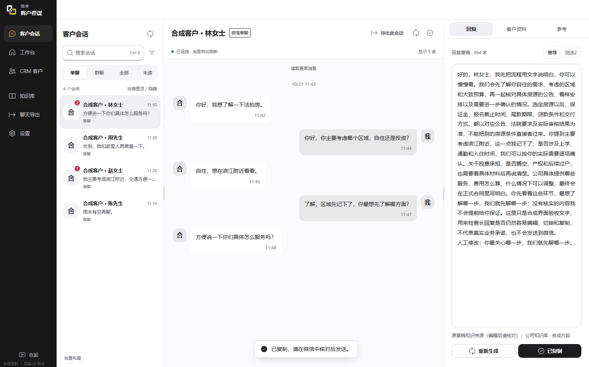

# 领序 · 客户参谋

面向 Windows 的客户沟通辅助工作台：结合会话、用户自己的知识资料和 CRM 信息，生成可编辑的回复建议。

这是桌面版 **0.11.5 的独立脱敏源码快照**。保留桌面界面、业务逻辑和测试；示例服务地址使用保留域名，演示资料均为虚构。应用生成建议，由使用者核对、编辑并复制发送。



## 功能

- 会话列表、上下文和回复草稿，支持三种布局、明暗皮肤与可调整分栏。
- 新消息到来时保留正在编辑的草稿，支持取消生成及丢弃迟到结果。
- 本地知识资料检索、CRM 只读适配和兼容 OpenAI 的模型接口；远程调用前确认发送范围。
- 本机微信会话只读适配、部分媒体元数据和离线语音能力，实际兼容性取决于客户端版本与本机授权。
- 会话与客户资料导出、资料来源核对、来源隔离和文件路径检查。

本仓库不包含 Android 模块、公司业务知识、云端服务、客户数据或可用账号。也没有桌面自动回复发送器、视频号自动接待或已发布的公共安装包。

## 开发运行

环境：Windows x64、Node.js 24 或更高版本、npm，以及软件所需的本机访问权限。Electron 为锁定依赖。

```powershell
npm ci
npm run native:download
npm run native:prepare
npm run native:verify
npm start
```

`native:download` 从 SQLite3 Multiple Ciphers 官方发布下载固定版本，核对压缩包和 DLL 的 SHA-256；不会下载闭源微信 DLL。其他原生桥接来自锁定的 npm 依赖。构建前会校验依赖和许可证。

首次运行使用独立的 `LingxuCopilotPublic` 用户目录，不继承内部版本的登录、模型密钥、账号选择或客户资料。知识库默认使用使用者提供的本地资料；模型及 CRM 由使用者自行配置，不预置账号与 API Key。离线语音模型需在界面中确认许可后另外下载。

## 验证

```powershell
npm run typecheck
npm run lint -- --max-warnings=0
npm test
npm run build:check
npm run ui:prepare
```

单元测试和界面检查使用合成资料。源码测试通过不代表任意微信版本、真实 CRM、模型或媒体格式都已验收。详细边界见 [架构与开发](docs/ARCHITECTURE.md) 和 [脱敏范围](docs/PUBLICATION.md)。

本公开快照的实际检查结果见 [验证记录](docs/VALIDATION.md)。

## 本地打包

完成上述验证后，可在 Windows 执行 `npm run release:windows`。公开副本使用独立的安装标识；自动更新默认关闭，没有连接内部更新渠道。未提供代码签名、公共更新服务器或预制安装程序。

## 许可与反馈

本仓库当前保持 **UNLICENSED / 保留权利**：公开可见不代表已授予开源再分发或商业使用许可。第三方组件分别遵守其原有许可，见 [第三方声明](THIRD_PARTY_NOTICES.md)。

请在 Issue 中只提交脱敏的问题描述、系统和软件版本、复现步骤及合成数据；不要上传聊天数据库、账号、号码、令牌或模型密钥。安全问题见 [安全说明](SECURITY.md)。本项目不隶属于微信或腾讯，也不承诺平台授权、账号不受限制或永久兼容。

---

Windows customer-conversation copilot. This repository contains a sanitized desktop source snapshot, synthetic examples and tests. It does not contain customer records, credentials, private service deployments, Android modules or an automatic WeChat message sender. Original code remains unlicensed unless a separate license is explicitly granted.
